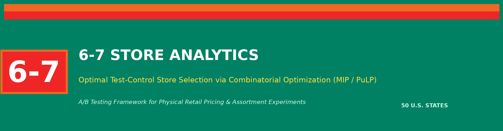
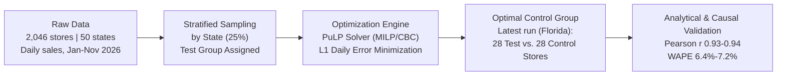
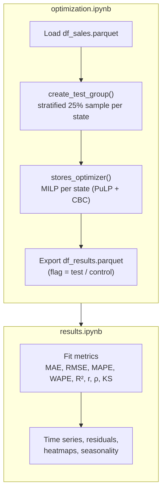
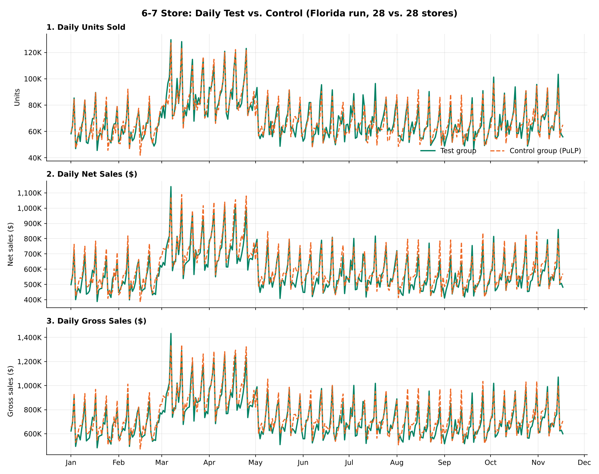
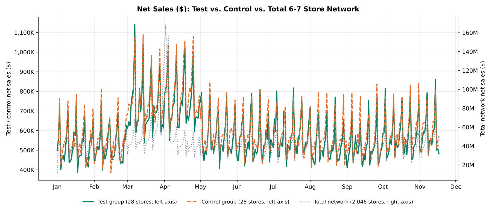
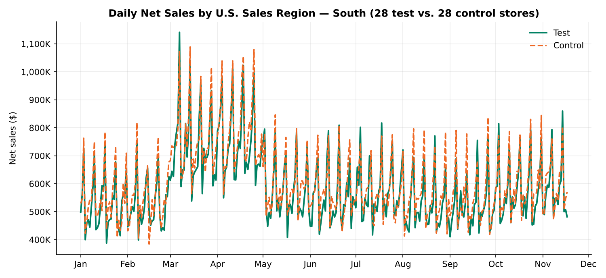
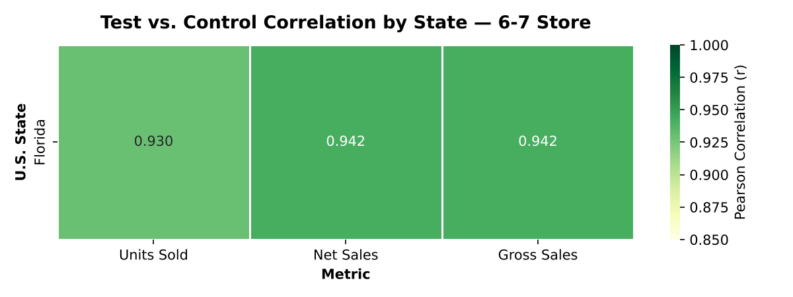
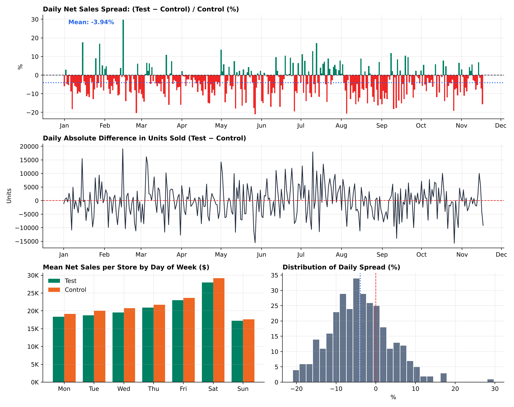

<div align="center">

# 🏪 6-7 STORE — OPTIMAL TEST-CONTROL SELECTION
### Combinatorial Optimization (MILP) for Brick-and-Mortar Retail Experimental Groups

[](https://www.python.org/)
[](https://coin-or.github.io/pulp/)
[](https://pandas.pydata.org/)
[](https://plotly.com/)
[](README.md)

<br/>



</div>

---

> [!NOTE]
> **Synthetic Data & Parody Disclaimer:**
> The dataset used in this repository is 100% synthetic, generated statistically to mimic real-world convenience retail dynamics (seasonality, macro trends, regional dispersion, and local shocks). The **"6-7 Store"** brand is a lighthearted parody inspired by the global convenience chain **7-Eleven** and has no corporate, commercial, or confidential affiliation with the trademark owner.

---

## ⚡ At a Glance

**The problem:** Before rolling out a new dynamic pricing model to a 2,000-store convenience chain, the company needs a clean A/B test. In physical retail, price can only vary by store, so the quality of the experiment depends on how well the control stores mirror the test stores.

**The solution:** A Mixed-Integer Linear Programming (MILP) model that, for each state, picks the group of control stores whose **combined daily sales curve best matches the test group's**, with the same number of stores in both groups.

| | |
| :--- | :--- |
| **Data** | 2,046 stores · 50 states · 4 U.S. regions · 632,215 store-day records · 321 days (Jan 1 – Nov 17, 2026) |
| **Method** | Stratified sampling (25% of stores per state) + MILP with an $L_1$ daily-error objective, solved with PuLP and COIN-OR CBC |
| **Latest run** | Florida: 28 test stores vs. 28 optimized control stores (solver time limit: 15 s) |
| **Fit quality** | Daily Pearson $r$ = **0.93** (units) and **0.94** (net and gross sales) · WAPE = **6.4%** (units) and **7.2%** (net sales) |
| **Skills shown** | Operations research · causal inference design · Python (PuLP, Pandas, SciPy) · statistical validation · data visualization |

---

## 📌 Table of Contents

1. [Introduction & Business Context](#1-introduction--business-context)
2. [The Challenge: A/B Testing in Brick-and-Mortar Retail](#2-the-challenge-ab-testing-in-brick-and-mortar-retail)
3. [Proposed Solution](#3-proposed-solution)
4. [MILP Mathematical Formulation](#4-milp-mathematical-formulation)
5. [Architecture & Workflow](#5-architecture--workflow)
6. [Experimental Results & Quantitative Validation](#6-experimental-results--quantitative-validation)
7. [Visual Diagnostics & Analysis](#7-visual-diagnostics--analysis)
8. [Limitations & Next Steps](#8-limitations--next-steps)
9. [Repository Structure](#9-repository-structure)
10. [Getting Started & Reproduction](#10-getting-started--reproduction)
11. [Conclusion & Business Impact](#11-conclusion--business-impact)

---

## 1. Introduction & Business Context

**6-7 Store** is a fictional large-scale convenience retail chain operating more than **2,000 brick-and-mortar stores** across **50 states** and **4 US Census regions** (*Midwest, Northeast, South,* and *West*).

Pricing and revenue leadership plans to roll out a **new predictive dynamic pricing and price elasticity model**. Before launching the algorithm nationwide, which would carry millions of dollars in revenue exposure and operational risk, the Data Science team needs empirical causal proof via a **store-level Controlled Experiment (A/B test)**.

To accurately measure incremental sales impact (*Average Treatment Effect*, or ATE, also called *lift*), the experiment must isolate exogenous drivers such as:
- Macroeconomic shifts;
- Weekly and weather-driven seasonality;
- Holidays and seasonal events;
- Local inflation trends.

This project (`optimal-store-test-control`) introduces a **Mixed-Integer Linear Programming (MILP)** matching framework that constructs a synthetic control store group whose historical sales trajectory closely mirrors the test group.

---

## 2. The Challenge: A/B Testing in Brick-and-Mortar Retail

While digital A/B testing (e-commerce and mobile apps) is straightforward, because traffic can be randomized at the user or session level via cookies or `user_id`, **physical store experimentation is fundamentally different and far more constrained**:

```
Digital Retail (E-commerce)               Brick-and-Mortar Retail
┌──────────────────────────────────┐      ┌───────────────────────────────────┐
│ • User/cookie-level randomization│      │ • Store-level randomization       │
│ • Zero physical/visual friction  │  VS  │ • Single shelf/POS price per store│
│ • Massive sample sizes (millions)│      │ • Finite population (~2,000 stores)│
│ • SUTVA holds more easily        │      │ • Spillover & cannibalization risk│
│ • Instant real-time rollbacks    │      │ • Operational & execution cost    │
└──────────────────────────────────┘      └───────────────────────────────────┘
```

### Key Challenges of Store-Level Experimentation:

1. **No In-Store Segmentation:** Charging one customer \$2.99 and another \$3.49 in the same checkout line is operationally unfeasible in a convenience store. Treatment must be assigned at the **store level**.
2. **High Store Heterogeneity:** Every physical location has distinct characteristics:
   - Selling floor area ($m^2$);
   - Location type (residential neighborhood vs. shopping center vs. highway fuel station);
   - Local median/per-capita income;
   - Foot and vehicle traffic;
   - Nearby competitor density.
3. **Selection Bias Risk:** Selecting control stores naively (e.g., simple historical averages, unstratified random draws, or manual regional manager picks) can introduce **pre-existing selection bias**, conflating baseline store differences with the pricing intervention.
4. **Causal Assumption Violations:** Quasi-experimental methods like *Difference-in-Differences* (DiD) rely on the **Parallel Trends Assumption**. Without tightly matched pre-intervention trajectories, causal estimates lose statistical validity.

---

## 3. Proposed Solution

To overcome common limitations of pointwise heuristics (such as *k-Nearest Neighbors* or individual *Propensity Score Matching*), this solution uses a two-stage design:



### Stage 1: Stratified Sampling (Test Group Assignment)
- A target test share is configured (set to **25%**).
- Test stores are sampled using **stratified sampling by state**, preserving geographic representation proportional to the overall store network.

### Stage 2: Global Combinatorial Matching (Control Group Selection)
- Rather than picking isolated "twin stores" one by one, which often misses portfolio-level aggregation dynamics, the problem is formulated as a **Mixed-Integer Linear Program (MILP)**.
- The solver evaluates candidate control stores within each state and selects the subset whose **aggregate daily sales curve tracks the test group's daily total**, minimizing total $L_1$ daily deviation while enforcing **exact store count parity**.

---

## 4. MILP Mathematical Formulation

The optimization problem is solved independently (and can be run in parallel) per state $e \in \mathcal{E}$ using **PuLP** with the open-source **COIN-OR CBC** solver.

### Notation:
- $\mathcal{S}$: Set of candidate control stores in the state ($\text{flag} = \text{control}$).
- $\mathcal{T}$: Set of observed historical days ($t \in \{1, 2, \dots, T\}$).
- $N_{\text{test}}$: Number of stores assigned to the test group in the state.
- $S_{i,t}$: Sales volume of candidate store $i \in \mathcal{S}$ on day $t \in \mathcal{T}$.
- $Y_t$: Total sales volume of the test group on day $t$:
  $$Y_t = \sum_{j \in \text{Test}} S_{j,t}$$

### Decision Variables:
1. **$x_i \in \{0, 1\}$**: Binary selection variable equal to $1$ if store $i$ is selected for the control group, and $0$ otherwise.
2. **$d_t \ge 0$**: Continuous auxiliary variable capturing the absolute daily sales difference between the selected control group and the test group on day $t$.

### Linear Programming Model:

$$\min \quad \sum_{t \in \mathcal{T}} d_t$$

**Subject to:**

1. **Daily Absolute Error Linearization ($L_1$ Norm):**
   For every day $t \in \mathcal{T}$:
   $$d_t \ge \sum_{i \in \mathcal{S}} x_i \cdot S_{i,t} - Y_t$$
   $$d_t \ge Y_t - \sum_{i \in \mathcal{S}} x_i \cdot S_{i,t}$$
   *(This standard linearization enforces $d_t \ge \left|\sum_{i} x_i S_{i,t} - Y_t\right|$ while keeping the objective and constraints strictly linear.)*

2. **Cardinality Parity:**
   The selected control group must contain the exact same number of stores as the test group:
   $$\sum_{i \in \mathcal{S}} x_i = N_{\text{test}}$$

3. **Variable Domains:**
   $$x_i \in \{0, 1\} \quad \forall i \in \mathcal{S}$$
   $$d_t \ge 0 \quad \forall t \in \mathcal{T}$$

The optimization target (`CRITERIA`) is configurable: `qty_sold`, `net_sales`, or `gross_sales`. The latest run matches on **`qty_sold`** (units sold).

---

## 5. Architecture & Workflow



---

## 6. Experimental Results & Quantitative Validation

Validation was run across **321 consecutive days in 2026** (January 1 – November 17) for the latest saved run: **28 test stores vs. 28 optimized control stores in Florida**. The optimization directly targeted `qty_sold` (unit volume). `net_sales` and `gross_sales` were *not* part of the objective, so they show how well a match on units carries over to revenue.

### Fit & Alignment Metrics:

| Metric | Pearson $r$ | Spearman $\rho$ | $R^2$ Score | MAE (Daily Mean Error) | WAPE (%) | MAPE (%) | Mean Difference (Test vs. Control) | KS $p$-value |
| :--- | :---: | :---: | :---: | :---: | :---: | :---: | :---: | :---: |
| **Units Sold (`qty_sold`)** | **0.9298** | **0.8744** | **0.8629** | 4,408 units | **6.37%** | **6.64%** | −0.23% | 0.562 |
| **Net Sales (`net_sales`)** | **0.9418** | **0.9015** | **0.8420** | \$42,035 | **7.20%** | **7.47%** | −4.19% | 0.006 |
| **Gross Sales (`gross_sales`)** | **0.9417** | **0.9013** | **0.8534** | \$50,029 | **6.89%** | **7.15%** | −3.59% | 0.022 |

Over the 321 days, the test group sold 22.22M units for \$187.3M in net sales, versus 22.27M units and \$195.5M for the control group.

> [!TIP]
> **Key Takeaways for Reviewers:**
> - **Strong co-movement.** Daily correlation is 0.93 on units and 0.94 on net and gross sales, and the control group explains roughly **84%–86%** of the test group's daily variance ($R^2$). This supports the parallel-trends assumption behind Difference-in-Differences.
> - **Daily error of about 6%–7% (WAPE).** Single days can deviate noticeably (the daily net sales spread ranges from about −21% to +30%), so pricing effects should be read over multi-week windows.
> - **Units match; revenue shows a level gap.** The unit distributions are statistically indistinguishable (KS $p$ = 0.56), but net and gross sales run about 3.6%–4.2% lower in the test group (KS $p$ < 0.05). Since the optimizer targeted units, this likely reflects a small difference in price or product mix between the two groups. DiD is robust to a constant level difference, but it is worth monitoring.

---

## 7. Visual Diagnostics & Analysis

### 7.1. Daily Time Series: Units, Net Sales, and Gross Sales (Test vs. Control)
The chart below shows how the selected control group tracks demand peaks, troughs, and seasonal trends across 2026:



---

### 7.2. Context: Test & Control vs. Total Network
The test and control groups (28 stores each, about 1.4% of the 2,046-store network) are plotted against the daily net sales of the entire chain (right axis) to show how the experimental groups relate to the overall trajectory:



---

### 7.3. Regional View
The saved run only contains stores from one state, so all test and control stores fall in the South region. The regional breakdown is built to cover all four US regions (*Midwest, Northeast, South,* and *West*) once the optimizer is run for every state:



---

### 7.4. State-Level Pearson Correlation Heatmap
The heatmap reports the daily correlation between test and control series for each state and metric. The latest run covers Florida (0.93–0.94); the same code produces one row per state when the full 50-state loop is executed:

<div align="center">
  
</div>

---

### 7.5. Day-of-Week Seasonality & Residual Distribution
The matched control group preserves the day-of-week pattern (Saturday peaks, Sunday troughs). The daily net sales spread averages −3.94%, with day-to-day noise of about 7.6 percentage points (standard deviation):



---

## 8. Limitations & Next Steps

Being explicit about what these results do and do not show:

- **In-sample fit.** The control group is optimized on the same 321 days used to evaluate it, so the reported fit is likely optimistic. A hold-out validation window (fit on the first months, evaluate on the rest) is the natural next check.
- **One state so far.** The saved results come from a single state. The code loops over every state, but state-level and regional consistency can only be claimed once all 50 states are run.
- **Revenue gap.** Matching on units leaves a ~4% net sales level gap. Optimizing on `net_sales`, or on a weighted mix of units and revenue, may close it.
- **Store attributes are not used.** Matching relies only on sales history. Adding store characteristics (size, location type, local income, competitor density) as constraints is a natural extension.

**Planned next steps:** run all 50 states, add hold-out validation and placebo tests, and evaluate multi-objective matching.

---

## 9. Repository Structure

```
retail-analytics/
│
├── README.md                                  # Complete project documentation (this file)
├── assets/                                    # Charts and banner used in this README
│   ├── hero_banner_6_7.png                    # 7-Eleven-inspired visual identity banner
│   ├── ts_daily_performance.png               # Daily time series: Test vs. Control
│   ├── ts_test_control_total.png              # Comparison against total chain volume
│   ├── regional_breakdown.png                 # Regional net sales: Test vs. Control
│   ├── correlation_heatmap.png                # State-level correlation heatmap
│   └── seasonality_and_residuals.png          # Weekly seasonality and residual diagnostics
│
└── optimal-store-test-control/
    ├── optimization.ipynb                     # Notebook 1: MILP formulation and solver execution
    ├── results.ipynb                          # Notebook 2: Analytics, fit metrics, and diagnostics
    ├── input_data/
    │   └── df_sales.parquet                   # Daily sales data (2,046 stores, 321 days)
    └── output_data/
        └── df_results.parquet                 # Dataset with 'test' and 'control' flags
```

| File / Directory | Description |
| :--- | :--- |
| [`optimal-store-test-control/optimization.ipynb`](optimal-store-test-control/optimization.ipynb) | Main notebook covering MILP model setup, stratified sampling, PuLP/CBC solving, and output export. |
| [`optimal-store-test-control/results.ipynb`](optimal-store-test-control/results.ipynb) | Analytics notebook with statistical metrics, Plotly visualizations, temporal analysis, and causal diagnostics. |
| [`optimal-store-test-control/input_data/`](optimal-store-test-control/input_data/) | Daily sales dataset in Parquet format (`df_sales.parquet`). |
| [`optimal-store-test-control/output_data/`](optimal-store-test-control/output_data/) | Output dataset with `test` and `control` flags for the selected stores (`df_results.parquet`). |
| [`assets/`](assets/) | Charts and figures rendered for the README. |

---

## 10. Getting Started & Reproduction

### Prerequisites
Python 3.10 or higher is recommended. The notebooks were run with PuLP 4.3.1 and Pandas 2.3.3.

### 1. Clone the repository
```bash
git clone https://github.com/krupck/retail-analytics.git
cd retail-analytics
```

### 2. Install dependencies
```bash
pip install pandas numpy pulp plotly matplotlib seaborn scipy tqdm pyarrow pytz
```

> [!NOTE]
> The notebook calls the solver through `pulp.COIN_CMD`, which expects a `cbc` executable on your `PATH` (for example, `apt install coinor-cbc` or `conda install -c conda-forge coincbc`). If you prefer to use the CBC binary bundled with PuLP, replace it with `pulp.PULP_CBC_CMD`.

### 3. Run the workflow
1. Open and run [optimization.ipynb](optimal-store-test-control/optimization.ipynb) to generate the control group and write `output_data/df_results.parquet`.
2. Open and run [results.ipynb](optimal-store-test-control/results.ipynb) to inspect similarity metrics, diagnostics, and interactive visuals.

---

## 11. Conclusion & Business Impact

This framework addresses a core bottleneck in physical retail experimentation: **measurement uncertainty caused by selection bias**.

### Key Business Benefits for 6-7 Store:
1. **Lower Risk on Pricing Rollouts:** Gives pricing leadership a defensible, data-driven control group before changes are deployed across hundreds or thousands of stores, so that any measured margin gain can be attributed to the new pricing algorithm rather than to pre-existing store differences.
2. **Practical Runtime Scalability:** Solving a linear MILP independently per state keeps each problem small. The solver is capped at 15 seconds per state, and the Florida run finished in about 15 seconds.
3. **Transparent Quality Checks:** Every control group ships with a full diagnostic report (correlation, WAPE, $R^2$, KS tests, seasonality and residual analysis), so analysts can judge the quality of the match before the experiment starts. The current results show a solid match (daily $r$ of 0.93–0.94, WAPE of 6%–7%) and a clear path to tighten it further.

---

<div align="center">
  <b>Built as a Data Science and Operations Research portfolio project for retail analytics.</b>
</div>
